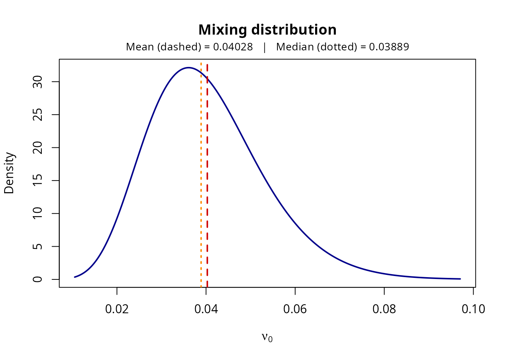
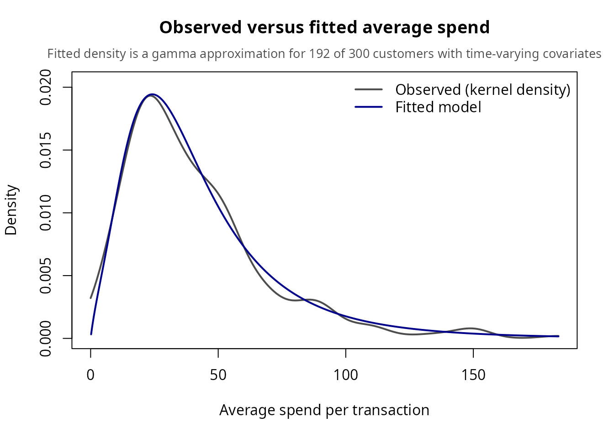
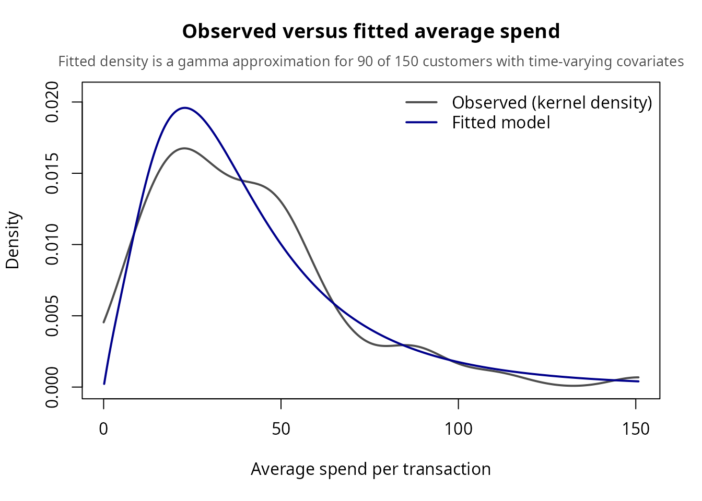
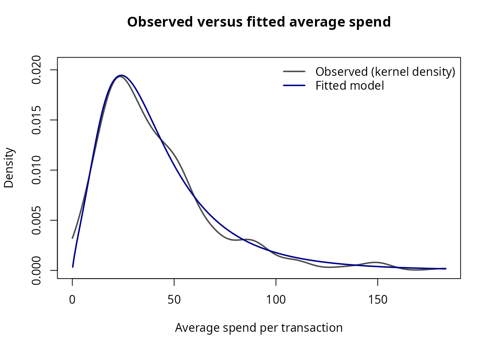
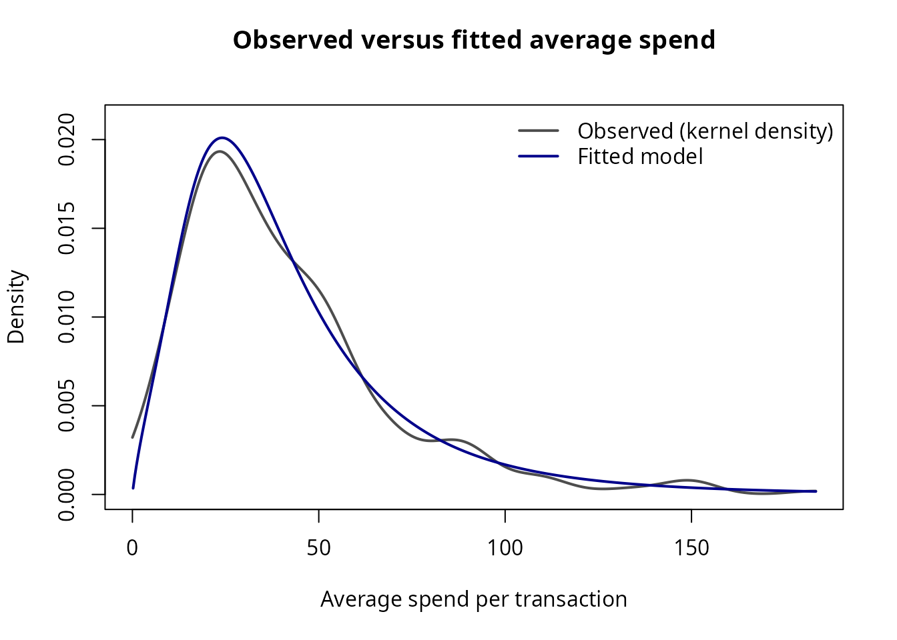

# Introduction to GammaGammaCov: Gamma-Gamma Spend Models with Covariates

## Package Overview

`GammaGammaCov` implements maximum likelihood estimation and diagnostic
plotting of the gamma-gamma model of spend per transaction, with
time-varying and time-invariant covariates (Fader and Hardie 2024). The
gamma-gamma model of spend is attributed to Colombo and Jiang (1999),
and Fader et al. (2005) used it for the monetary-value component of
their customer lifetime value (CLV) framework.

| Function                                                                                               | Purpose                                                                                                                                                            |
|:-------------------------------------------------------------------------------------------------------|:-------------------------------------------------------------------------------------------------------------------------------------------------------------------|
| [`GGcov_MLE()`](https://kaloklee.github.io/GammaGammaCov/reference/GGcov_MLE.md)                       | Maximum likelihood estimation with covariates (time-varying, static, or none)                                                                                      |
| [`print()`](https://rdrr.io/r/base/print.html)                                                         | S3 print method displaying estimates, SEs, and Wald confidence intervals                                                                                           |
| [`GGcov_plot_mixing()`](https://kaloklee.github.io/GammaGammaCov/reference/GGcov_plot_mixing.md)       | Plot the gamma mixing distribution of the baseline spending rate $\nu_{0}$ across the customer base                                                                |
| [`GGcov_plot_avg_spend()`](https://kaloklee.github.io/GammaGammaCov/reference/GGcov_plot_avg_spend.md) | Compare the observed distribution of customers’ average spend per transaction with the distribution implied by the fitted model                                    |
| [`GGcov_expected_spend()`](https://kaloklee.github.io/GammaGammaCov/reference/GGcov_expected_spend.md) | Posterior conditional expectation of the monetary value of a future transaction, given the customer’s history and the (known) covariate values of that transaction |

------------------------------------------------------------------------

## The Gamma-Gamma Model with Covariates

The model *without* covariates rests on three assumptions: a customer’s
transaction monetary values vary randomly around their average; the
average transaction monetary value varies across customers but not over
time for a given customer; and the distribution of the averages is
independent of the transaction process (Fader and Hardie 2013).

Formally, for a customer with $x$ transactions, let $z_{1},\ldots,z_{x}$
denote the monetary value of each transaction. Given the customer’s
baseline rate $\nu_{0}$, the values are independent and gamma
distributed with shape $p$ and rate $\nu_{j}$, where the covariates
$\mathbf{w}_{j}$ in effect at transaction $j$ shift the rate $\nu_{0}$:

$$z_{j} \mid \nu_{0} \sim \text{Gamma}\left( p,\ \nu_{j} \right),\qquad\nu_{j} = \nu_{0}e^{-\mathbf{w}_{j}\beta\prime},$$

so the mean of $z_{j}$ is $p\, e^{\mathbf{w}_{j}\beta\prime}/\nu_{0}$.
Across customers, $\nu_{0} \sim \text{Gamma}(q,\gamma)$ with shape $q$
and rate $\gamma$ captures unobserved heterogeneity.

$$L(p,q,\gamma,\beta) = \frac{\left\{ \prod\limits_{j = 1}^{x}z_{j} \right\}^{p - 1}A(x)}{\Gamma(p)^{x}} \cdot \frac{\Gamma(px + q)}{\Gamma(q)} \cdot \frac{\gamma^{q}}{\left( \gamma + B(x) \right)^{px + q}},$$

where $A(x) = e^{-p\sum_{j = 1}^{x}\mathbf{w}_{j}\beta\prime}$ and
$B(x) = \sum_{j = 1}^{x}z_{j}e^{-\mathbf{w}_{j}\beta\prime}$. The full
likelihood is the product over customers.

### Required Format for the Data

Data must be in **transaction (long) format**:

- One row per transaction.
- A customer identifier column linking rows to the same customer.
- The amount spent, which must be strictly positive (drop zero-value
  transactions first).
- The covariates in effect at the time of each transaction.

| Column                      | Type             | Description                                                       |
|:----------------------------|:-----------------|:------------------------------------------------------------------|
| `Id`                        | Identifier       | Unique customer identifier (numeric, character, or factor)        |
| `Price`                     | Numeric          | Amount spent in the transaction (strictly positive)               |
| `discount, gender, channel` | Numeric / Factor | Dynamic or static covariates (continuous, binary, or multi-level) |

Row order does not matter, and no time index is needed. A static
covariate is included by repeating its value on each of the customer’s
rows. Factor and character covariates are expanded into dummy variables
through standard R formula mechanics (`model.matrix`, treatment
contrasts).

## Example 1: Time-Varying Covariates (`spend_data_sample`)

> **Note on Datasets:** To ensure this vignette builds rapidly within
> CRAN limits, we evaluate the models using `spend_data_sample`, a small
> subset of the package’s full simulated data intended for quick trials
> and interactive exploration. For full empirical analyses, use the
> entire cohort via `spend_data <- GammaGammaCov::spend_data`. The
> syntax remains identical.

The data are simulated (see
[`?spend_data`](https://kaloklee.github.io/GammaGammaCov/reference/spend_data.md))
to mimic the structure of retail transaction logs with covariates, such
as the apparel example in the CLVTools vignette (Bachmann et al. 2025).
Each row represents one transaction. We print the first rows to
illustrate the structure.

``` r
library(GammaGammaCov)

# Load the quick-start sample dataset
spend_data_sample <- GammaGammaCov::spend_data_sample

# Inspect the transaction data structure
head(spend_data_sample, 10)
#>    Id Price discount gender channel
#> 1   1 14.93     0.31   male   store
#> 2   1 21.12     0.01   male   store
#> 3   5 67.71     0.54   male   store
#> 4   5 45.59     0.29   male   store
#> 5   5 44.78     0.08   male   store
#> 6   5 84.33     0.11   male   store
#> 7   5 40.91     0.46   male   store
#> 8   5 39.09     0.12   male   store
#> 9   5  1.07     0.50   male   store
#> 10  5 43.67     0.23   male   store
```

We estimate the model by directly supplying the formula and the subject
identifier.

``` r
fit_varying <- GGcov_MLE(
  Price ~ discount + gender + channel,
  data    = spend_data_sample,
  subject = "Id"
)

# View parameter estimates, standard errors, and Wald confidence intervals
print(fit_varying)
#> Gamma-gamma model 
#> 
#>                      Estimate Std. Error Lower 95% Upper 95%
#> p (shape)              1.9180    0.09844    1.7350    2.1210
#> q (mixture shape)      9.6130    2.20000    6.1390   15.0500
#> gamma (mixture rate) 238.6000   66.28000  138.5000  411.3000
#> discount              -0.6560    0.17840   -1.0060   -0.3064
#> gendermale            -0.2609    0.06924   -0.3967   -0.1252
#> channelweb             0.3511    0.08093    0.1924    0.5097
#> channelapp            -0.3867    0.08946   -0.5621   -0.2114
#> 
#> Negative log-likelihood: 3981.2844
#> Convergence code: 0
```

### Interpreting the Coefficients

Each coefficient $\beta_{k}$ acts multiplicatively on spend: a one-unit
increase in a numeric covariate, or a switch from the reference level to
a given factor level, multiplies mean spend per transaction by
$e^{\beta_{k}}$. A positive $\beta_{k}$ raises spend; a negative
$\beta_{k}$ lowers it. Each non-reference level of a factor gets its own
coefficient, labeled with the variable name and the level (for example
`channelweb`).

The mixing distribution of $\nu_{0}$ describes customers at zero for
numeric covariates and at the reference level of each factor.
Coefficients are expressed per unit of each covariate, so raw
coefficients are not comparable across covariates measured on different
scales. To make an effect concrete, compute $e^{\beta_{k}\Delta}$ for a
meaningful change $\Delta$. An effect is distinguishable from zero when
the confidence interval for $\beta_{k}$ excludes $0$.

### Visualizing the Mixing Distribution

We can visualize the implied distribution of the baseline spending rate
$\nu_{0}$ across customers, a gamma distribution with shape $q$ and rate
$\gamma$:

``` r
GGcov_plot_mixing(fit_varying)
```



> **A note on $q$ and $\gamma$:** The two parameters are often highly
> correlated, because many $(q,\gamma)$ combinations imply very similar
> distributions of $\nu_{0}$. Interpret them jointly, for example
> through the mixing distribution shown by
> [`GGcov_plot_mixing()`](https://kaloklee.github.io/GammaGammaCov/reference/GGcov_plot_mixing.md),
> rather than one at a time.

### Checking the Fit: Observed versus Fitted Average Spend

A natural check of the fitted model compares the observed distribution
of each customer’s average spend per transaction,
$\bar{z} = \frac{1}{x}\sum_{j = 1}^{x}z_{j}$, with the distribution the
model implies (Fader and Hardie 2013, Figure 3).
[`GGcov_plot_avg_spend()`](https://kaloklee.github.io/GammaGammaCov/reference/GGcov_plot_avg_spend.md)
draws both.

**The model density of $\bar{z}$.** For a customer with $x$
transactions, let $S = \sum_{j = 1}^{x}z_{j}$ be the total spend, so
that $\bar{z} = S/x$, and write $\eta_{j} = \mathbf{w}_{j}\beta\prime$.
The model says that, given the customer’s $\nu_{0}$, the transactions
are independent with
$z_{j} \mid \nu_{0} \sim \text{Gamma}\left( p,\ \nu_{0}e^{-\eta_{j}} \right)$.
We need the distribution of $\bar{z}$ after averaging over
$\nu_{0} \sim \text{Gamma}(q,\gamma)$.

With time-varying covariates, the rates $\nu_{0}e^{-\eta_{j}}$ differ
across a customer’s transactions, and a sum of gamma variables with
different rates has no simple closed form. We tackle this problem with
the Satterthwaite–Welch approximation (Satterthwaite 1946; Welch 1947),
which was developed for weighted sums of chi-square variables, such as
combinations of variance estimates. A chi-square variable with $d$
degrees of freedom is a gamma variable with shape $d/2$ and rate $1/2$,
so the same moment matching applies to gamma variables with any positive
shape $p$. The derivation follows the stages of Fader and Hardie (2013):
the distribution of the total spend given $\nu_{0}$, the distribution of
the average given $\nu_{0}$, and then the integration over $\nu_{0}$.

1.  *The total spend given $\nu_{0}$.* Given $\nu_{0}$, transaction $j$
    has mean $p\, e^{\eta_{j}}/\nu_{0}$ and variance
    $p\, e^{2\eta_{j}}/\nu_{0}^{2}$. The transactions are independent,
    so their means and variances add. With
    $a_{1} = \sum_{j = 1}^{x}e^{\eta_{j}}$ and
    $a_{2} = \sum_{j = 1}^{x}e^{2\eta_{j}}$,

$$E\left( S \mid \nu_{0} \right) = \frac{p\, a_{1}}{\nu_{0}},\qquad\text{Var}\left( S \mid \nu_{0} \right) = \frac{p\, a_{2}}{\nu_{0}^{2}}.$$

A $\text{Gamma}(k,r)$ distribution has mean $k/r$ and variance
$k/r^{2}$. Setting the two pairs equal and solving gives the
approximation

$$S \mid \nu_{0}\; \approx \;\text{Gamma}(k,r),\qquad k = \frac{p\, a_{1}^{2}}{a_{2}},\quad r = \nu_{0}\,\frac{a_{1}}{a_{2}}.$$

2.  *The average spend given $\nu_{0}$.* Dividing a gamma variable by
    $x$ multiplies its rate by $x$, so the average $\bar{z} = S/x$
    satisfies

$$\bar{z} \mid \nu_{0}\; \approx \;\text{Gamma}\left( k,\ \nu_{0}\,\frac{x\, a_{1}}{a_{2}} \right).$$

3.  *Integrating out $\nu_{0}$.* Averaging this density over
    $\nu_{0} \sim \text{Gamma}(q,\gamma)$ works exactly as in Fader and
    Hardie (2013), with $px$ replaced by $k$ and $x$ replaced by
    $x\, a_{1}/a_{2}$. The density of the average spend of a customer
    with $x$ transactions is

$$f\left( \bar{z} \right) = \frac{\Gamma(k + q)}{\Gamma(k)\,\Gamma(q)} \cdot \frac{\left( x\, a_{1}/a_{2} \right)^{k}{\bar{z}}^{\, k - 1}\,\gamma^{q}}{\left( \gamma + \bar{z}\, x\, a_{1}/a_{2} \right)^{k + q}},\qquad k = \frac{p\, a_{1}^{2}}{a_{2}}.$$

Written out in terms of the raw sums, this is

$$f\left( \bar{z} \right) = \frac{\Gamma(k + q)}{\Gamma(k)\,\Gamma(q)} \cdot \frac{\left( \frac{x\sum\limits_{j = 1}^{x}e^{\eta_{j}}}{\sum\limits_{j = 1}^{x}e^{2\eta_{j}}} \right)^{k}{\bar{z}}^{\, k - 1}\,\gamma^{q}}{\left( \gamma + \bar{z}\,\frac{x\sum\limits_{j = 1}^{x}e^{\eta_{j}}}{\sum\limits_{j = 1}^{x}e^{2\eta_{j}}} \right)^{k + q}},\qquad k = \frac{p\left( \sum\limits_{j = 1}^{x}e^{\eta_{j}} \right)^{2}}{\sum\limits_{j = 1}^{x}e^{2\eta_{j}}}.$$

Each customer needs only $x$, $a_{1}$ and $a_{2}$, which are three sums
over their transactions. The fitted curve in the plot is the average of
these densities over the customers in the data.

*One formula for every case.* The same expression covers the model
without covariates, static covariates and time-varying covariates. Only
the values of $a_{1}$ and $a_{2}$ change:

| Case                                  | $a_{1}$                | $a_{2}$                 | $k$                           | $x\, a_{1}/a_{2}$ | Density of $\bar{z}$ |
|:--------------------------------------|:-----------------------|:------------------------|:------------------------------|:------------------|:---------------------|
| No covariates ($\eta_{j} = 0$)        | $x$                    | $x$                     | $px$                          | $x$               | exact                |
| Static covariates ($\eta_{j} = \eta$) | $x\, e^{\eta}$         | $x\, e^{2\eta}$         | $px$                          | $x\, e^{-\eta}$   | exact                |
| Time-varying covariates               | $\sum_{j}e^{\eta_{j}}$ | $\sum_{j}e^{2\eta_{j}}$ | $p\, a_{1}^{2}/a_{2} \leq px$ | $x\, a_{1}/a_{2}$ | approximate          |

In the first two rows, all of a customer’s rates are equal, so the gamma
distribution in step 1 is the exact distribution of $S \mid \nu_{0}$,
namely $\text{Gamma}\left( px,\ \nu_{0}e^{-\eta} \right)$. Substituting
the table entries into the formula gives

$$f\left( \bar{z} \right) = \frac{\Gamma(px + q)}{\Gamma(px)\,\Gamma(q)} \cdot \frac{\left( x\, e^{-\eta} \right)^{px}{\bar{z}}^{\, px - 1}\,\gamma^{q}}{\left( \gamma + x\, e^{-\eta}\,\bar{z} \right)^{px + q}},$$

which is the exact density of $\bar{z}$. With $\eta = 0$ it is Equation
(1a) of Fader and Hardie (2013). Only the third row is an approximation.
By the Cauchy–Schwarz inequality $a_{1}^{2} \leq x\, a_{2}$, so
$k \leq px$, with equality exactly when all of a customer’s covariate
effects are equal, which is the case in the first two rows.

*How good is the approximation?* Because the mean and variance of
$S \mid \nu_{0}$ are matched for every $\nu_{0}$, the mean and variance
of $\bar{z}$ are reproduced exactly, whenever they exist. Higher moments
are not matched, so the density itself is approximate. An exact density
exists as an infinite series of gamma densities (Moschopoulos 1985), but
it is much heavier to compute. Since the purpose of this plot is to
judge visually how well the model fits the data, an approximation that
gets the mean and variance right is acceptable.

``` r
GGcov_plot_avg_spend(fit_varying, spend_data_sample)
```



The grey curve is a kernel density estimate of the observed averages and
the blue curve is the fitted model. Because this model has time-varying
covariates, the note above the plot reports how many customers’
densities use the approximation.

**A hold-out check.** The fitted parameters are used as they are, and
nothing is refitted, so `data` can be any transaction data frame with
the same columns. This allows a check on customers the model has not
seen: fit the model on one part of the customers and compare the model
with the observed averages of the rest. The split must be by customer,
so that each customer’s transactions stay together.

``` r
set.seed(2024)
ids       <- unique(spend_data_sample$Id)
train_ids <- sample(ids, length(ids) / 2)

train <- spend_data_sample[spend_data_sample$Id %in% train_ids, ]
test  <- spend_data_sample[!spend_data_sample$Id %in% train_ids, ]

fit_train <- GGcov_MLE(
  Price ~ discount + gender + channel,
  data    = train,
  subject = "Id"
)

GGcov_plot_avg_spend(fit_train, test)
```



The blue curve comes from the model fitted on `train` alone, and the
grey curve shows the observed averages of the customers in `test`. The
two agree when the model describes new customers well. Every factor
level in `test` must also appear in `train`, because the model has no
coefficient for a level it has not seen.

### Posterior Conditional Expectation of Future Spend

A natural next question is how much a customer will spend on their
*next* transaction.
[`GGcov_expected_spend()`](https://kaloklee.github.io/GammaGammaCov/reference/GGcov_expected_spend.md)
computes the **conditional expectation of the monetary value of a future
transaction $Z_{k}$, given the customer’s observed history
$\left( z_{1},\ldots,z_{x} \right)$ with covariates
$\left( \mathbf{w}_{1},\ldots,\mathbf{w}_{x} \right)$, and the covariate
values $\mathbf{w}_{k}$ of the future transaction, which are assumed
known**. The covariates of a future transaction are inputs, not
predictions: for example, the discount planned for the next purchase.

The derivation has three steps (Fader and Hardie 2024).

1.  *Posterior of the customer’s baseline rate.* The prior
    $\nu_{0} \sim \text{Gamma}(q,\gamma)$ multiplied by the customer’s
    likelihood, which as a function of $\nu_{0}$ is proportional to
    $\nu_{0}^{px}e^{-\nu_{0}B{(x)}}$, gives

$$\nu_{0} \mid \text{history} \sim \text{Gamma}\left( px + q,\ \gamma + B(x) \right).$$

The history enters only through the number of transactions $x$ and
$B(x) = \sum_{i = 1}^{x}z_{i}e^{-\mathbf{w}_{i}\beta\prime}$, the
observed spends rescaled to the baseline (all covariates at zero).

2.  *Expected spend given $\nu_{0}$.* For a future transaction with
    covariates $\mathbf{w}_{k}$,

$$E\left( Z_{k} \mid \nu_{0},\mathbf{w}_{k} \right) = \frac{p\, e^{\mathbf{w}_{k}\beta\prime}}{\nu_{0}}.$$

3.  *Average over the posterior of $\nu_{0}$.* For a gamma distribution
    with shape $px + q > 1$ and rate $\gamma + B(x)$,
    $E\left( 1/\nu_{0} \mid \text{history} \right) = \left( \gamma + B(x) \right)/(px + q - 1)$.
    Therefore

$$E\left( Z_{k} \mid z_{1},\ldots,z_{x},\mathbf{w}_{1},\ldots,\mathbf{w}_{x},\mathbf{w}_{k} \right) = \frac{p\left( \gamma + B(x) \right)}{px + q - 1}\, e^{\mathbf{w}_{k}\beta\prime}.$$

This is Equation (8) of Fader and Hardie (2024).

The expression can be read as a weighted average. Writing $B(x)/x$ for
the customer’s average spend adjusted to the baseline,

$$E\left( Z_{k} \mid \cdot \right) = e^{\mathbf{w}_{k}\beta\prime}\left\lbrack \frac{px}{px + q - 1} \cdot \frac{B(x)}{x} + \frac{q - 1}{px + q - 1} \cdot \frac{p\gamma}{q - 1} \right\rbrack,$$

so the prediction shrinks the customer’s own (baseline-adjusted) average
toward the population mean $p\gamma/(q - 1)$, and the weight on the
customer’s own history grows with the number of transactions $x$. The
factor $e^{\mathbf{w}_{k}\beta\prime}$ then moves the prediction to the
covariate values of the future transaction. A customer with no history
($x = 0$ and $B(x) = 0$) gets the prior expectation
$p\gamma e^{\mathbf{w}_{k}\beta\prime}/(q - 1)$, which requires $q > 1$.

Here we predict the next transaction of every customer in the sample at
a 10% discount, keeping each customer’s gender and channel (taken from
their last observed row). `newdata` has one row per future transaction
to predict, and `history` holds the observed transactions:

``` r
last_rows <- spend_data_sample[!duplicated(spend_data_sample$Id, fromLast = TRUE), ]
future <- last_rows[, c("Id", "discount", "gender", "channel")]
future$discount <- 0.1

pred_varying <- GGcov_expected_spend(fit_varying,
                                     newdata = future,
                                     history = spend_data_sample)
head(pred_varying)
#>   Id n_trans expected_spend
#> 1  1       2       32.23626
#> 2  5      12       49.09745
#> 3  6       3       84.06568
#> 4  9       2       25.53577
#> 5 10       2       48.92893
#> 6 12      11       57.29205
```

The result has one row per row of `newdata`, with the number of past
transactions used (`n_trans`) and the expected spend. Because the future
covariates are inputs, the same customers can be compared under
different scenarios, here no discount against a 30% discount:

``` r
spend_0  <- GGcov_expected_spend(fit_varying, transform(future, discount = 0),
                                 spend_data_sample)$expected_spend
spend_30 <- GGcov_expected_spend(fit_varying, transform(future, discount = 0.3),
                                 spend_data_sample)$expected_spend

head(data.frame(Id = future$Id, no_discount = spend_0, discount_30 = spend_30))
#>   Id no_discount discount_30
#> 1  1    34.42191    28.27247
#> 2  5    52.42632    43.06041
#> 3  6    89.76544    73.72893
#> 4  9    27.26712    22.39588
#> 5 10    52.24637    42.91261
#> 6 12    61.17652    50.24739
```

------------------------------------------------------------------------

## Example 2: Static Covariates

If covariates are fixed for each customer, repeat their values across
the customer’s rows. The same function applies:

``` r
fit_static <- GGcov_MLE(
  Price ~ gender + channel,
  data    = spend_data_sample,
  subject = "Id",
  level   = 0.99
)

print(fit_static)
#> Gamma-gamma model 
#> 
#>                      Estimate Std. Error Lower 99% Upper 99%
#> p (shape)              1.8990    0.09718    1.6640   2.16600
#> q (mixture shape)      9.2300    2.05600    5.2010  16.38000
#> gamma (mixture rate) 200.3000   53.52000  100.7000 398.70000
#> gendermale            -0.2758    0.07001   -0.4562  -0.09552
#> channelweb             0.3364    0.08182    0.1256   0.54710
#> channelapp            -0.3831    0.09059   -0.6164  -0.14970
#> 
#> Negative log-likelihood: 3987.8839
#> Convergence code: 0
```

### Checking the Fit

With static covariates, each customer’s covariate effect is the same on
every transaction, so the fitted density of $\bar{z}$ is exact and no
approximation note appears:

``` r
GGcov_plot_avg_spend(fit_static, spend_data_sample)
```



### Posterior Conditional Expectation of Future Spend

With static covariates the future covariate values are known by
construction: they are the customer’s own, unchanged, so
$\mathbf{w}_{k} = \mathbf{w}$ for every transaction. Then
$B(x) = e^{-\mathbf{w}\beta\prime}\sum_{i = 1}^{x}z_{i} = y\, e^{-\mathbf{w}\beta\prime}$,
where $y$ is the customer’s total observed spend, and the expression
from Example 1 reduces to

$$E\left( Z_{k} \mid z_{1},\ldots,z_{x},\mathbf{w} \right) = \frac{p\left( \gamma + y\, e^{-\mathbf{w}\beta\prime} \right)}{px + q - 1}\, e^{\mathbf{w}\beta\prime},$$

which is Equation (4) of Fader and Hardie (2024). The time-varying
expression therefore contains the static one as a special case, and the
same function computes both. We supply each customer’s static covariates
as the covariates of the next transaction:

``` r
customers <- spend_data_sample[!duplicated(spend_data_sample$Id),
                               c("Id", "gender", "channel")]

pred_static <- GGcov_expected_spend(fit_static,
                                    newdata = customers,
                                    history = spend_data_sample)
head(pred_static)
#>   Id n_trans expected_spend
#> 1  1       2       29.69254
#> 2  5      12       45.00187
#> 3  6       3       83.75598
#> 4  9       2       23.26665
#> 5 10       2       44.89116
#> 6 12      11       52.20558
```

------------------------------------------------------------------------

## Example 3: The Null Model

Use `~ 1` to fit the model without covariates, which estimates only $p$,
$q$ and $\gamma$:

``` r
fit_null <- GGcov_MLE(Price ~ 1, data = spend_data_sample, subject = "Id")
print(fit_null)
#> Gamma-gamma model 
#> 
#>                      Estimate Std. Error Lower 95% Upper 95%
#> p (shape)               1.901    0.09849     1.717     2.104
#> q (mixture shape)       5.631    0.95590     4.037     7.853
#> gamma (mixture rate)  106.000   22.53000    69.920   160.800
#> 
#> Negative log-likelihood: 4017.5628
#> Convergence code: 0
```

The null model is nested in any covariate model (all coefficients equal
to zero), so a likelihood-ratio test compares them. Both models must be
fitted to the same data. The statistic is compared to a chi-square
distribution with one degree of freedom per coefficient:

``` r
lr <- 2 * (fit_null$value - fit_varying$value)
df <- length(fit_varying$par) - length(fit_null$par)
pchisq(lr, df = df, lower.tail = FALSE)
#> [1] 6.545324e-15
```

### Checking the Fit

Without covariates, $a_{1} = a_{2} = x$, so $k = px$ and the fitted
density of $\bar{z}$ is exact. This is the comparison shown in Figure 3
of Fader and Hardie (2013):

``` r
GGcov_plot_avg_spend(fit_null, spend_data_sample)
```



### Posterior Conditional Expectation of Future Spend

Without covariates, $e^{\mathbf{w}_{k}\beta\prime} = 1$ and
$B(x) = \sum_{i = 1}^{x}z_{i} = x\bar{z}$, where $\bar{z}$ is the
customer’s average observed spend. The conditional expectation of a
future transaction’s monetary value given the history then simplifies to

$$E\left( Z_{k} \mid z_{1},\ldots,z_{x} \right) = \frac{p\left( \gamma + x\bar{z} \right)}{px + q - 1} = \frac{px}{px + q - 1}\,\bar{z} + \frac{q - 1}{px + q - 1} \cdot \frac{p\gamma}{q - 1},$$

a weighted average of the customer’s observed average spend and the
population mean $p\gamma/(q - 1)$ (Fader and Hardie 2013). No covariate
values are needed, so `newdata` only has to identify the customers:

``` r
customer_ids <- data.frame(Id = unique(spend_data_sample$Id))

pred_null <- GGcov_expected_spend(fit_null,
                                  newdata = customer_ids,
                                  history = spend_data_sample)
head(pred_null)
#>   Id n_trans expected_spend
#> 1  1       2       32.02839
#> 2  5      12       47.73239
#> 3  6       3       95.65402
#> 4  9       2       33.75960
#> 5 10       2       53.72940
#> 6 12      11       52.56280
```

Comparing the prediction with each customer’s raw average shows the
shrinkage: customers with few transactions are pulled most strongly
toward the population mean.

``` r
observed <- aggregate(Price ~ Id, data = spend_data_sample, FUN = mean)
names(observed)[2] <- "observed_mean"

comparison <- merge(pred_null, observed, by = "Id")
head(comparison[order(comparison$n_trans), ])
#>    Id n_trans expected_spend observed_mean
#> 7  13       1       34.23385         11.60
#> 10 18       1       39.33251         29.12
#> 13 24       1       84.14946        183.12
#> 14 28       1       35.26988         15.16
#> 18 43       1       37.37977         22.41
#> 23 59       1       38.40415         25.93
```

------------------------------------------------------------------------

## References

- Bachmann, P., Kuebler, N., Meierer, M., Naef, J., Oblander, E., &
  Schilter, P. (2025). *CLVTools: Tools for Customer Lifetime Value
  Estimation*. R package version 0.12.1.
  <https://github.com/bachmannpatrick/clvtools>
- Colombo, R., & Jiang, W. (1999). A stochastic RFM model. *Journal of
  Interactive Marketing*, 13(3), 2–12.
- Fader, P. S., & Hardie, B. G. S. (2013). *The Gamma-Gamma Model of
  Monetary Value* (Research Note No. 025).
  <https://brucehardie.com/notes/025/>
- Fader, P. S., & Hardie, B. G. S. (2024). *Incorporating Covariates in
  the Gamma-Gamma Spend Model* (Research Note No. 045).
  <https://brucehardie.com/notes/045/>
- Fader, P. S., Hardie, B. G. S., & Lee, K. L. (2005). RFM and CLV:
  Using iso-value curves for customer base analysis. *Journal of
  Marketing Research*, 42(4), 415–430.
- Moschopoulos, P. G. (1985). The distribution of the sum of independent
  gamma random variables. *Annals of the Institute of Statistical
  Mathematics*, 37, 541–544. <https://doi.org/10.1007/BF02481123>
- Satterthwaite, F. E. (1946). An approximate distribution of estimates
  of variance components. *Biometrics Bulletin*, 2(6), 110–114.
  <https://doi.org/10.2307/3002019>
- Welch, B. L. (1947). The generalization of “Student’s” problem when
  several different population variances are involved. *Biometrika*,
  34(1/2), 28–35. <https://doi.org/10.2307/2332510>

------------------------------------------------------------------------

## Session Information

``` r
sessionInfo()
#> R version 4.6.2 (2026-10-29)
#> Platform: x86_64-pc-linux-gnu
#> Running under: LMDE 7 (gigi)
#> 
#> Matrix products: default
#> BLAS:   /usr/lib/x86_64-linux-gnu/openblas-pthread/libblas.so.3 
#> LAPACK: /usr/lib/x86_64-linux-gnu/openblas-pthread/libopenblasp-r0.3.29.so;  LAPACK version 3.12.0
#> 
#> locale:
#>  [1] LC_CTYPE=en_US.UTF-8       LC_NUMERIC=C              
#>  [3] LC_TIME=en_US.UTF-8        LC_COLLATE=en_US.UTF-8    
#>  [5] LC_MONETARY=en_US.UTF-8    LC_MESSAGES=en_US.UTF-8   
#>  [7] LC_PAPER=en_US.UTF-8       LC_NAME=C                 
#>  [9] LC_ADDRESS=C               LC_TELEPHONE=C            
#> [11] LC_MEASUREMENT=en_US.UTF-8 LC_IDENTIFICATION=C       
#> 
#> time zone: America/Kentucky/Louisville
#> tzcode source: system (glibc)
#> 
#> attached base packages:
#> [1] stats     graphics  grDevices utils     datasets  methods   base     
#> 
#> other attached packages:
#> [1] GammaGammaCov_0.1.0
#> 
#> loaded via a namespace (and not attached):
#>  [1] digest_0.6.39     desc_1.4.3        R6_2.6.1          fastmap_1.2.0    
#>  [5] xfun_0.62         cachem_1.1.0      knitr_1.52        htmltools_0.5.9  
#>  [9] rmarkdown_2.32    lifecycle_1.0.5   cli_3.6.6         sass_0.4.10      
#> [13] pkgdown_2.2.1     textshaping_1.0.5 jquerylib_0.1.4   systemfonts_1.3.2
#> [17] compiler_4.6.2    tools_4.6.2       ragg_1.5.2        bslib_0.12.0     
#> [21] evaluate_1.0.5    yaml_2.3.12       otel_0.2.0        jsonlite_2.0.0   
#> [25] rlang_1.3.0       fs_2.1.0          htmlwidgets_1.6.4
```
